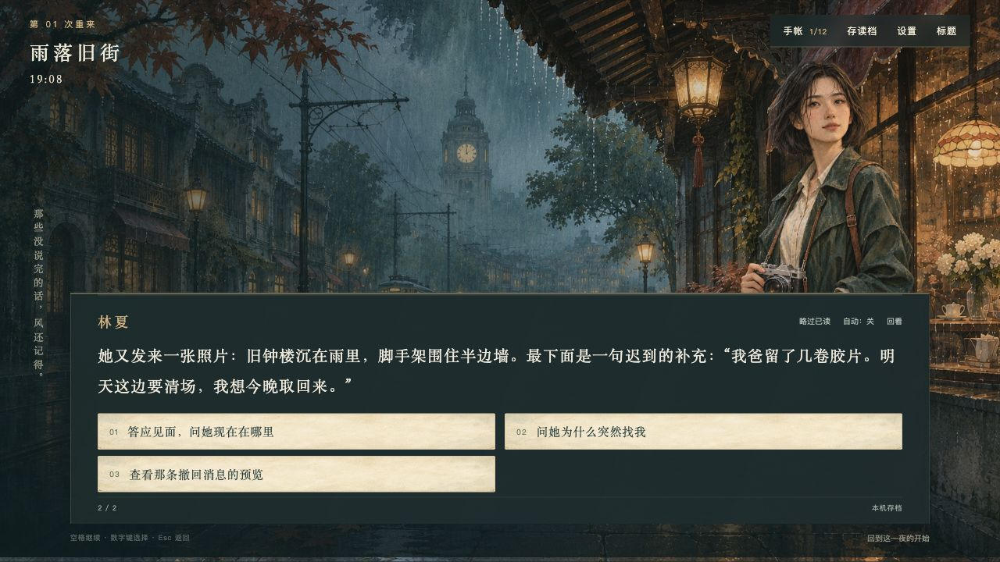
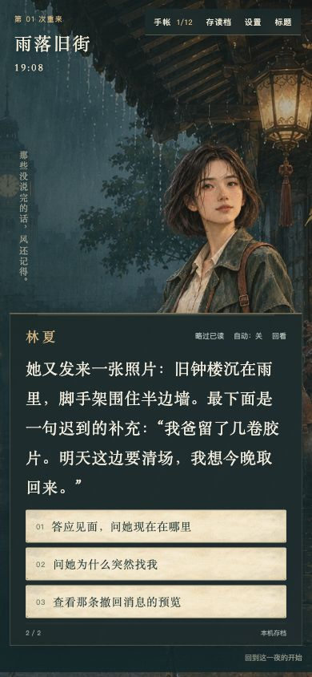

# 再赴晚风

> 如果那天的晚风，再吹一次。这一次，你会听见她没有说完的话吗？

一部完整的中文原创循环叙事游戏。故事从 **19:07** 的一条邀约开始：老街即将改变，旧友林夏想取回父亲留下的胶片。你能记住已经发生的事情，却需要重新学习怎样陪她走过这一夜。


## 游戏内容

- **127 个剧情节点、12 项跨周目记忆、8 个结局**，包含完整真结局。
- 六处手绘场景：雨夜老街、咖啡馆、电车站、档案室、旧钟楼、雨后黎明。
- 观察场景，获得线索；把上一轮获知的信息带回对话，打开新的选择。
- 记忆手帐、结局收藏、对话回看、自动阅读、略过已读、字号与减少动态设置。
- 自动保存与 **3 栏手动书签**；读回旧路线不会抹掉后来获得的记忆。
- 原创生成位图美术与三首作者通过 Stable Audio 生成的场景配乐。视觉素材不使用 SVG 或 Emoji 堆砌。
- 桌面和手机触控均可游玩；完整主线与全部结局不要求观看广告。

## 星匣草稿与广告

星匣游戏 ID：**11640**，编辑版本 **34501**。本次交付已保存为创作者草稿，未正式公开发布；公开游玩页在正式发布前可能不可用。创作者可在 [星匣创作后台](https://game.virtualoverapp.com/home) 查看《再赴晚风》。上传后的全部游戏文件均已核对 HTTP 状态、MIME 类型与内容哈希。

使用官方 GameSDK **v2 IIFE**，实现依据官方文档快照 **v2.7.2 / rev43**：

- `sdk.storage` 保存完整进度、书签、设置、跨周目记忆及提示账本。
- `sdk.exchange.exchange({ via: 'ad', deliver })` 接入官方激励视频广告。
- 广告兑换项 **7519：回忆提示**，合同为 `memory_hint × 1`、观看 1 次、星光币费用 0；创建时已获审核通过并上架。
- 玩家主动从“记忆手帐 → 给下一步一点提示”进入广告。奖励只在官方 `deliver` 回调中持久化成功后发放，取消、失败和未完成均无奖；相同订单不会重复发放。
- 独立本机版不会伪造平台广告；提示按钮会明确显示当前不可用。原有剧情和线索始终可以免费探索。

兑换项审核通过、接口测试通过，与真实设备是否有广告库存是不同状态。广告实际展示受平台宿主、登录及供应商库存影响，平台集成和验收边界详见 [平台接入说明](docs/platform-integration.md)。

## 场景配乐

| 曲目 | 场景 | 播放方式 |
| --- | --- | --- |
| 晚风还记得（180秒） | 标题、老街、咖啡馆、车站、档案室及普通落幕 | 循环 |
| 停在21:17（90秒） | 钟楼调查与取回胶片 | 循环 |
| 第25张照片（90秒） | 黎明与真结局 | 单次播放 |

配乐使用192kbps MP3，三首总计约8.64MB。场景之间约1.1秒交叉淡变，同曲场景切换不从头播放。广告、切后台和关闭配乐会暂停，恢复后接续原位置。悬疑曲降低播放音量以平衡三首响度。原WAV未修改，来源和转换记录见[配乐素材说明](docs/audio-assets.md)。

## 本地运行

需要 **Node.js 20 或更新版本**，无第三方运行时依赖。

```bash
npm run dev
```

打开终端显示的 `http://127.0.0.1:7417`。直接双击 HTML 会受 ES Module 和文件协议限制，请使用本地服务器。

```bash
npm test          # 剧情可达性、存读档、云存储和广告行为
npm run check    # 节点引用、素材、声明与无 SVG/Emoji 检查
npm run build    # 生成 dist/，仅包含游戏与正式美术
```

## 操作

| 操作 | 方法 |
| --- | --- |
| 阅读、显示完整文字 | 点击“继续”或正文；空格 / Enter |
| 选择行动 | 点击选项，或按数字键 |
| 观察环境 | 点击场景上方的“观察”按钮 |
| 查看记忆与提示 | “手帐” |
| 保存、恢复路线 | “存读档”中的三张书签 |
| 重开循环 | “回到这一夜的开始”，保留全部记忆与结局 |
| 关闭窗口 | “合上”或 Esc |

自动阅读在需要选择时停止，切到后台会暂停；略过已读只略过已读文字，不替玩家选择。音乐需首次用户点击后启动。

## 画面





## 项目结构

```text
index.html / styles.css / app.js  页面、交互与阅读体验
story.js                         完整中文剧情、记忆与结局
engine.js                        循环状态、条件选择、书签和提示寻路
platform.js                      星匣云存档及激励广告适配
sound.js                         场景配乐、交叉淡变与暂停恢复
assets/                          正式生成位图
scripts/                         本地服务、构建、静态检查
tests/                           游戏和平台行为测试
docs/                            剧情设计、美术提示词、平台与验收记录
star-letter.json                 星匣草稿清单
```

## 灵感与授权边界

玩法参考 [Paper Dino 的《Save the Date》](https://paperdino.com/save-the-date/) 中反复赴约、记忆解锁新对话的思路。**本作是独立原创作品，不是该游戏的官方中文翻译、授权移植或原作脚本复刻**。未收录其对白、角色、美术、音频、代码和具体故事。

本作的中文故事、人物、结局、程序及生成美术均为重新制作。美术使用内置 imagegen 工具生成，最终资产、提示词和处理记录见 [美术生成记录](docs/art-prompts.md)。三首音乐由项目作者使用 Stable Audio 生成并提供，来源和转换记录见[配乐素材说明](docs/audio-assets.md)。

源代码采用 [MIT License](LICENSE)。原创剧情和项目内位图的再使用说明见 [素材与内容许可](ASSET-LICENSE.md)。贡献与再发布时请保留原作灵感说明，不应宣称为《Save the Date》的官方汉化。
